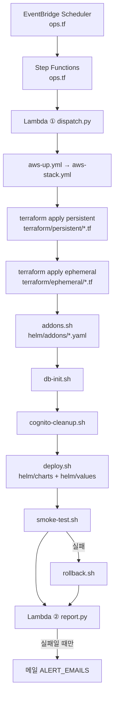
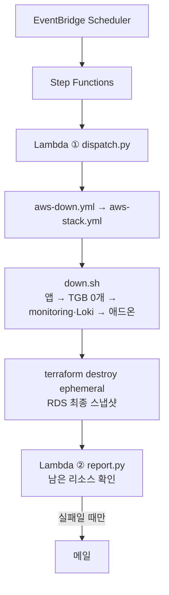
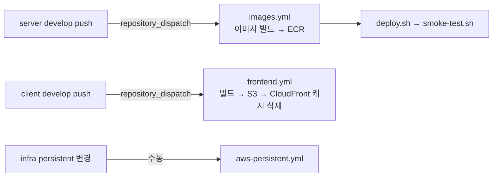
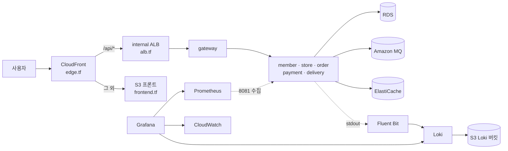

# 배달싹 infra 파일 구조 v1

- 작성: 이서진 (2026-10-28)
- 대상: `SeSac-4/baedalsak-infra` `develop` (파일 79개)
- 범위: 레포 안 모든 파일의 종류 · 역할 · 실행 시점 · 서로의 연결

## 목차

1. [한눈에 보기 — 폴더 구조](#1-한눈에-보기--폴더-구조)
2. [파일 종류](#2-파일-종류)
3. [실행 흐름 다이어그램](#3-실행-흐름-다이어그램)
4. [폴더별 파일 설명](#4-폴더별-파일-설명)
5. [값이 들어오는 경로](#5-값이-들어오는-경로)
6. [수정 규칙](#6-수정-규칙)

---

## 1. 한눈에 보기 — 폴더 구조

```text
baedalsak-infra/
├── .github/
│   ├── dependabot.yml                 [yml]  액션 버전 업데이트 PR (주 1회)
│   └── workflows/                     ── GitHub Actions (실행 담당)
│       ├── aws-stack.yml              [yml]  공통 본체 (아래 5개가 호출)
│       ├── aws-plan.yml               [yml]  변경 미리보기 (plan)
│       ├── aws-persistent.yml         [yml]  상시 스택만 적용
│       ├── aws-up.yml                 [yml]  켜기 (평일 09:30)
│       ├── aws-down.yml               [yml]  끄기 (평일 19:00)
│       ├── images.yml                 [yml]  서버 이미지 빌드 → ECR
│       └── frontend.yml               [yml]  클라이언트 빌드 → S3·CloudFront
│
├── terraform/                         ── AWS 리소스 정의 (IaC)
│   ├── bootstrap/                     처음 1번만 (로컬 apply)
│   │   └── main.tf                    [tf]   state 버킷 · GitHub OIDC · Actions 역할
│   ├── persistent/                    상시 유지 (매일 지우지 않음)
│   │   ├── main.tf                    [tf]   ECR · Secrets Manager · Loki 버킷 · RDS 파라미터
│   │   ├── variables.tf               [tf]   입력 변수 (TF_VAR_*)
│   │   ├── cognito.tf                 [tf]   사용자 풀 2개 · 그룹 · 앱 클라이언트 · SSM
│   │   ├── dns.tf                     [tf]   Route 53 · ACM 인증서 2개
│   │   ├── frontend.tf                [tf]   프론트 S3 · OAC · CF Function
│   │   ├── ses.tf                     [tf]   메일 발송 도메인 · 수신자 인증
│   │   ├── audit.tf                   [tf]   CloudTrail · 로그 버킷
│   │   ├── ops.tf                     [tf]   켜기·끄기 자동화 · 알림 · Budgets · 비용 메일
│   │   └── lambda/                    Lambda 코드 (ops.tf 가 배포)
│   │       ├── dispatch.py            [py]   ① GitHub 워크플로 실행
│   │       ├── report.py              [py]   ② 켜기·끄기 결과 확인 → 실패 시 메일
│   │       ├── budget_guard.py        [py]   ③ 예산 초과 → 끄기
│   │       ├── cost_report.py         [py]   ④ 일일 비용 메일
│   │       ├── test_report.py         [py]   ② 자체 검사 (배포 안 됨)
│   │       └── test_cost_report.py    [py]   ④ 자체 검사 (배포 안 됨)
│   └── ephemeral/                     매일 생성(09:30) · 삭제(19:00)
│       ├── versions.tf                [tf]   provider · state · persistent 출력 읽기
│       ├── variables.tf               [tf]   입력 변수 (TF_VAR_*)
│       ├── network.tf                 [tf]   VPC · 서브넷 · NAT · 보안그룹
│       ├── eks.tf                     [tf]   EKS · 노드그룹 (t3.large 2/2/4)
│       ├── iam.tf                     [tf]   Pod Identity 권한 (애드온·서비스별)
│       ├── data.tf                    [tf]   RDS · Amazon MQ · ElastiCache · SSM 값
│       ├── alb.tf                     [tf]   internal ALB · 대상 그룹
│       ├── edge.tf                    [tf]   CloudFront · VPC origin · 도메인 연결
│       ├── alarms.tf                  [tf]   CloudWatch 알람
│       └── outputs.tf                 [tf]   출력값 (클러스터 이름 · 주소 등)
│
├── helm/                              ── 쿠버네티스 배포 정의
│   ├── charts/baedalsak-service/      앱 6개 공통 차트
│   │   ├── Chart.yaml                 [yaml] 차트 이름 · 버전
│   │   ├── values.yaml                [yaml] 기본값
│   │   └── templates/                 [yaml·tpl] 쿠버네티스 리소스 틀 (4장)
│   ├── values/                        차트에 넣는 값 (팀 결정값)
│   │   ├── services/<서비스>.yaml      [yaml] 서비스 특성 6개
│   │   ├── local.yaml                 [yaml] 로컬(minikube) 환경
│   │   └── aws.yaml                   [yaml] AWS(EKS) 환경
│   └── addons/                        외부 차트 설정 (addons.sh 가 사용)
│       ├── kube-prometheus-stack.yaml [yaml] Prometheus · Grafana
│       ├── loki.yaml                  [yaml] Loki (로그 저장)
│       └── aws-for-fluent-bit.yaml    [yaml] Fluent Bit (로그 수집)
│
├── scripts/                           ── 실행 스크립트
│   ├── aws/                           GitHub Actions 가 순서대로 실행
│   │   ├── env.sh                     [sh]   공통 변수 (다른 sh 가 읽음)
│   │   ├── addons.sh                  [sh]   애드온 설치
│   │   ├── db-init.sh                 [sh]   DB · MQ 초기화
│   │   ├── cognito-cleanup.sh         [sh]   Cognito 사용자 정리
│   │   ├── deploy.sh                  [sh]   앱 6개 배포
│   │   ├── smoke-test.sh              [sh]   배포 확인
│   │   ├── rollback.sh                [sh]   배포 실패 시 되돌리기
│   │   ├── down.sh                    [sh]   끄기 전 정리
│   │   └── tunnel.sh                  [sh]   팀원 PC → AWS 접속 터널
│   └── hpa-load.sh                    [sh]   HPA 부하 테스트 (로컬)
│
├── local/
│   └── traefik-values.yaml            [yaml] 로컬 Ingress(Traefik) 설정
│
├── docs/                              ── 문서
│   ├── aws-runbook.md                 [md]   AWS 운영 매뉴얼
│   ├── 관측성/배달싹_관측성_백엔드_설정요청_v1.md [md] 백엔드 관측성 요청서
│   ├── 배달싹_infra_파일구조_v1.md      [md]   이 문서
│   ├── claude-code-prompt.md          [md]   Claude Code 작업 프롬프트
│   └── share-2026-10-14-ingress-actuator.md [md] 10-14 공유 문서
│
├── Makefile                           [make] 로컬 minikube 명령 모음
├── README.md                          [md]   레포 소개 · 구성
├── .env.example                       [env]  환경 변수 목록 (값 없음)
└── .gitignore                         [txt]  커밋 제외 목록 (.env · tfstate 등)
```

- `terraform/*/.terraform.lock.hcl` (3개): Terraform provider 버전 고정 파일. 자동 생성 · 직접 수정 안 함

---

## 2. 파일 종류

| 번호 | 확장자 | 종류 | 누가 읽고 실행하나 | 이 레포에서 하는 일 |
| --- | --- | --- | --- | --- |
| 1 | `.tf` | Terraform (HCL) | `terraform apply` (GitHub Actions) | AWS 리소스(VPC · EKS · RDS · S3 · IAM 등) 정의 |
| 2 | `.lock.hcl` | Terraform 잠금 파일 | `terraform init` | provider 버전 고정 |
| 3 | `.py` | Python | AWS Lambda | 켜기·끄기 실행 · 결과 확인 · 비용 메일 |
| 4 | `.sh` | Bash 스크립트 | GitHub Actions · 사람 | helm · kubectl · aws cli 명령 묶음 |
| 5 | `.yml` (`.github/`) | GitHub Actions 워크플로 | GitHub | 언제 · 어떤 순서로 실행할지 |
| 6 | `.yaml` (`helm/`) | Helm values | `helm upgrade` | 차트에 넣는 설정값 |
| 7 | `.yaml` · `.tpl` (`templates/`) | Helm 템플릿 | `helm` | 값을 채워 쿠버네티스 리소스(Deployment 등) 생성 |
| 8 | `Makefile` | Make | `make <명령>` | 로컬 minikube 명령 모음 |
| 9 | `.md` | Markdown | 사람 | 문서 |
| 10 | `.env.example` | 환경 변수 예시 | 사람 (복사해 `.env`) | 필요한 변수 이름 목록. 값은 넣지 않음 |
| 11 | `.gitignore` | Git 설정 | Git | `.env` · `*.tfstate*` · `.terraform/` 커밋 제외 |

---

## 3. 실행 흐름 다이어그램

### 3-1. 매일 켜기 (평일 09:30, 약 25분)



### 3-2. 매일 끄기 (평일 19:00)



### 3-3. 코드가 바뀌었을 때



### 3-4. 클러스터 안 구성 (켜진 동안)



---

## 4. 폴더별 파일 설명

### 4-1. `.github/workflows/` — GitHub Actions

| 번호 | 파일 | 종류 | 실행 시점 | 하는 일 |
| --- | --- | --- | --- | --- |
| 1 | `aws-stack.yml` | yml | 직접 실행 안 함 | 공통 본체. 아래 워크플로가 `action` 값을 넘겨 호출. 로그 가림(마스킹) 포함 |
| 2 | `aws-plan.yml` | yml | 수동 | 두 스택 `terraform plan` (아무것도 바꾸지 않음) |
| 3 | `aws-persistent.yml` | yml | 수동 · persistent 코드 변경 시 | persistent 스택만 apply |
| 4 | `aws-up.yml` | yml | 평일 09:30 자동 · 수동 | 켜기 전체 (3-1) |
| 5 | `aws-down.yml` | yml | 평일 19:00 자동 · 수동 | 끄기 전체 (3-2) · 최종 스냅샷 7개만 보관 |
| 6 | `images.yml` | yml | server develop push · 수동 | 서비스 6개 이미지 빌드(amd64) → ECR → 배포 |
| 7 | `frontend.yml` | yml | client develop push · 수동 | `npm run build` → S3 → CloudFront 캐시 삭제 |
| 8 | `../dependabot.yml` | yml | 주 1회 | 워크플로 액션 새 버전 PR |

### 4-2. `terraform/bootstrap/` — 처음 1번

| 번호 | 파일 | 종류 | 만드는 것 |
| --- | --- | --- | --- |
| 1 | `main.tf` | tf | Terraform state 버킷 · GitHub OIDC provider · GitHub Actions 역할. state 는 로컬 파일(커밋 안 함) |

### 4-3. `terraform/persistent/` — 상시 유지

| 번호 | 파일 | 종류 | 만드는 것 · 하는 일 |
| --- | --- | --- | --- |
| 1 | `main.tf` | tf | ECR 6개(최신 7개 보관) · Secrets Manager(서비스별 · infra · grafana · seed) · Loki S3 버킷(15일 만료) · RDS 파라미터 그룹(KST · 슬로우 쿼리) |
| 2 | `variables.tf` | tf | 입력 변수 정의. 값은 `TF_VAR_*` 환경 변수로만 받음 |
| 3 | `cognito.tf` | tf | 사용자 풀 2개(prod · 로컬, Lite) · 그룹 CUSTOMER/OWNER/RIDER · 앱 클라이언트 · SSM `cognito_*` |
| 4 | `dns.tf` | tf | Route 53 존 참조 · ACM ①(us-east-1, CloudFront) · ②(서울, ALB) |
| 5 | `frontend.tf` | tf | 프론트 S3 버킷 · OAC · CloudFront Function(SPA 새로고침 404 방지) |
| 6 | `ses.tf` | tf | SES 도메인 자격 · DKIM · 수신자 이메일 인증(샌드박스) |
| 7 | `audit.tf` | tf | CloudTrail(관리 이벤트) · 로그 버킷(ALB 액세스 로그 30일) |
| 8 | `ops.tf` | tf | Scheduler(켜기 · 끄기 · 비용 메일) · Step Functions · Lambda 4개 · SNS 알림 · Budgets($5 경고 · $10 끄기) |

### 4-4. `terraform/persistent/lambda/` — Lambda 코드

| 번호 | 파일 | 종류 | 실행 시점 | 하는 일 |
| --- | --- | --- | --- | --- |
| 1 | `dispatch.py` | py | 켜기 · 끄기 시작 | Step Functions 작업 토큰을 받아 GitHub 워크플로 실행 |
| 2 | `report.py` | py | 켜기 · 끄기 끝 | GitHub 실패 job · 로그 + AWS 실제 상태 확인 → **실패일 때만** 메일 |
| 3 | `budget_guard.py` | py | 예산 $10 초과 | 끄기 실행 |
| 4 | `cost_report.py` | py | 매일 09:00 | 전날 비용 · 서비스별 · 스택 태그별 표 메일 (SES) |
| 5 | `test_report.py` | py | 사람이 로컬에서 | `report.py` 자체 검사 (Lambda 에 안 올라감) |
| 6 | `test_cost_report.py` | py | 사람이 로컬에서 | `cost_report.py` 자체 검사 (Lambda 에 안 올라감) |

### 4-5. `terraform/ephemeral/` — 매일 생성 · 삭제

| 번호 | 파일 | 종류 | 만드는 것 |
| --- | --- | --- | --- |
| 1 | `versions.tf` | tf | provider · state 위치 · persistent 출력값 읽기(`local.p`) |
| 2 | `variables.tf` | tf | 입력 변수 (`TF_VAR_*`) |
| 3 | `network.tf` | tf | VPC 10.0.0.0/16 · public · EKS private · data 서브넷 각 2개 · NAT 1개 · 보안그룹 |
| 4 | `eks.tf` | tf | EKS · 관리형 노드그룹(t3.large, 최소 2 · 최대 4) · 접근 권한 |
| 5 | `iam.tf` | tf | Pod Identity 역할: LBC · Cluster Autoscaler · ESO · Loki(S3) · Grafana(CloudWatch 읽기) · SES 발송 · member(Cognito) · Bastion |
| 6 | `data.tf` | tf | RDS PostgreSQL 16 · Amazon MQ · ElastiCache · SSM 값(주소 등) |
| 7 | `alb.tf` | tf | internal ALB(443 · 80) · gateway 대상 그룹 |
| 8 | `edge.tf` | tf | CloudFront · VPC origin · Route 53 도메인 연결 |
| 9 | `alarms.tf` | tf | CloudWatch 알람 → SNS → 메일 |
| 10 | `outputs.tf` | tf | 클러스터 이름 · RDS · MQ · Redis 주소 · ALB · Bastion · CloudFront ID |

### 4-6. `helm/charts/baedalsak-service/` — 앱 6개 공통 차트

| 번호 | 파일 | 종류 | 만드는 쿠버네티스 리소스 · 하는 일 |
| --- | --- | --- | --- |
| 1 | `Chart.yaml` | yaml | 차트 이름 · 버전 |
| 2 | `values.yaml` | yaml | 기본값 (포트 · probe · 리소스 · 보안 · ExternalSecret 설정) |
| 3 | `templates/_helpers.tpl` | tpl | 공통 함수 (이름 · 라벨 · 이미지 주소 · Secret 이름) |
| 4 | `templates/deployment.yaml` | yaml | Deployment (컨테이너 · 8080/8081 포트 · env · probe · 보안) |
| 5 | `templates/service.yaml` | yaml | Service (`http://<서비스>:8080`) |
| 6 | `templates/configmap.yaml` | yaml | 비밀 아닌 환경 변수 (DB · MQ · Redis 주소 등) |
| 7 | `templates/externalsecret.yaml` | yaml | ExternalSecret — Secrets Manager · SSM 값을 Secret 으로 (운영) |
| 8 | `templates/serviceaccount.yaml` | yaml | ServiceAccount (Pod Identity 연결 대상) |
| 9 | `templates/hpa.yaml` | yaml | HPA (CPU 기준 자동 확장) |
| 10 | `templates/pdb.yaml` | yaml | PDB (gateway 최소 1개 유지) |
| 11 | `templates/targetgroupbinding.yaml` | yaml | TargetGroupBinding — gateway 파드를 ALB 대상 그룹에 등록 (운영) |
| 12 | `templates/ingress.yaml` | yaml | Ingress (로컬 Traefik) |
| 13 | `templates/middleware.yaml` | yaml | Traefik Middleware — `/api` 제거 (로컬, 현재 꺼짐) |

### 4-7. `helm/values/` — 차트에 넣는 값 (팀 결정값)

| 번호 | 파일 | 종류 | 내용 |
| --- | --- | --- | --- |
| 1 | `services/gateway.yaml` | yaml | 외부 진입점 · DB 없음 · Cognito issuer(SSM) |
| 2 | `services/member.yaml` | yaml | DB member · Redis 세션 · Flyway seed · Cognito 풀 · 클라이언트 ID(SSM) |
| 3 | `services/store.yaml` · `order.yaml` · `payment.yaml` · `delivery.yaml` | yaml | 서비스별 DB 계정 · schema · 사용하는 의존성 · HPA 범위 |
| 4 | `local.yaml` | yaml | 로컬: `host.minikube.internal` · 리소스 · Ingress |
| 5 | `aws.yaml` | yaml | AWS: ExternalSecret · TLS · 리소스. 환경별 값은 `deploy.sh` 가 채움 |

- 적용 순서: 차트 `values.yaml` → `services/<서비스>.yaml` → `local.yaml` 또는 `aws.yaml` → `deploy.sh --set`

### 4-8. `helm/addons/` — 외부 차트 설정 (`addons.sh` 가 사용)

| 번호 | 파일 | 종류 | 설치 대상 | 핵심 설정 |
| --- | --- | --- | --- | --- |
| 1 | `kube-prometheus-stack.yaml` | yaml | Prometheus · Grafana (92.14.0) | 디스크 없음 · 보관 1일 · Alertmanager 끔 · 앱 8081 수집 · 데이터소스 Loki · CloudWatch |
| 2 | `loki.yaml` | yaml | Loki (7.3.0) | 파드 1개 · tsdb + S3 · 14일 · gateway · 캐시 끔 · 테넌트 1개 |
| 3 | `aws-for-fluent-bit.yaml` | yaml | Fluent Bit (0.2.0) | CloudWatch 끔 · Loki 출력 · 라벨 namespace · service · level |

### 4-9. `scripts/` — 실행 스크립트

| 번호 | 파일 | 종류 | 실행 시점 | 하는 일 |
| --- | --- | --- | --- | --- |
| 1 | `aws/env.sh` | sh | 다른 sh 가 먼저 읽음 | 공통 변수(NAME · SECRET_PREFIX · SSM_PREFIX · NS) · `ssm` 함수 |
| 2 | `aws/addons.sh` | sh | 켜기 (ephemeral 직후) | LBC · Cluster Autoscaler · ESO · SecretStore 2개 · metrics-server · Loki · Fluent Bit · Prometheus · Grafana |
| 3 | `aws/db-init.sh` | sh | 켜기 | RDS 서비스별 DB · 계정 5개 · MQ vhost (클러스터 안 Job) |
| 4 | `aws/cognito-cleanup.sh` | sh | 켜기 | prod 풀 username 1000 이상 삭제 (seed 1~999 유지) |
| 5 | `aws/deploy.sh` | sh | 켜기 · 이미지 배포 | 앱 6개 `helm upgrade` · 이전 리비전 기록 |
| 6 | `aws/smoke-test.sh` | sh | 배포 직후 | 파드 Ready · 대상 그룹 · readiness · 라우팅 · 공개 경로 확인 (`API=/api/v1`) |
| 7 | `aws/rollback.sh` | sh | smoke test 실패 | 직전 정상 리비전으로 `helm rollback` |
| 8 | `aws/down.sh` | sh | 끄기 (destroy 전) | 앱 → TGB 0개 → monitoring · Loki → 애드온 순서로 삭제 |
| 9 | `aws/tunnel.sh` | sh | 팀원이 필요할 때 | Bastion 경유 SSM 포트포워딩 (api · db 등) |
| 10 | `hpa-load.sh` | sh | 로컬 테스트 | 서비스에 부하를 줘 HPA 확장 확인 |

### 4-10. 루트 · 기타

| 번호 | 파일 | 종류 | 하는 일 |
| --- | --- | --- | --- |
| 1 | `Makefile` | make | 로컬 minikube: `make up` · `secret` · `deploy` · `tunnel` 등 |
| 2 | `local/traefik-values.yaml` | yaml | 로컬 Ingress 컨트롤러(Traefik) 설정 |
| 3 | `.env.example` | env | 필요한 환경 변수 이름 목록 (값 없음, 복사해 `.env`) |
| 4 | `.gitignore` | txt | 커밋 제외 (`.env` · `*.tfstate*` · `.terraform/` 등) |
| 5 | `README.md` | md | 레포 소개 · 로컬/AWS 구성 · 환경 변수 표 |
| 6 | `docs/aws-runbook.md` | md | AWS 운영 매뉴얼 (실행 · 접속 · 문제 해결) |
| 7 | `docs/관측성/배달싹_관측성_백엔드_설정요청_v1.md` | md | 백엔드 관측성 설정 요청서 |
| 8 | `docs/claude-code-prompt.md` | md | Claude Code 작업 프롬프트 |
| 9 | `docs/share-2026-10-14-ingress-actuator.md` | md | 10-14 공유: Ingress 404 · actuator 포트 분리 |

---

## 5. 값이 들어오는 경로

| 번호 | 값 종류 | 원본 위치 | 전달 경로 | 사용처 |
| --- | --- | --- | --- | --- |
| 1 | 이름 규칙 · 리전 (PROJECT · ENV_NAME · AWS_REGION) | GitHub 레포 Variables | 워크플로 env → `TF_VAR_*` · `env.sh` | tf · sh |
| 2 | 계정이 드러나는 값 (AWS_ROLE_ARN · TF_STATE_BUCKET 등) · 메일 | GitHub 레포 Secrets | 워크플로 env (로그 가림) | tf · sh |
| 3 | 비밀번호 (DB · MQ · Redis · Grafana · 토스) | Secrets Manager `<SECRET_PREFIX>/*` (Terraform `random_password` 또는 콘솔 입력) | ESO `aws-secrets-manager` → K8s Secret → env | 앱 · Grafana |
| 4 | 설정값 (Cognito 풀 ID 등) | SSM `<SSM_PREFIX>/cognito_*` (persistent) | ESO `aws-parameter-store` → K8s Secret → env | member · gateway |
| 5 | 매일 바뀌는 주소 (RDS · MQ · Redis · ALB · 대상 그룹 · Loki 버킷) | SSM `<SSM_PREFIX>/*` (ephemeral · persistent) | `env.sh` 의 `ssm` 함수 → `--set` | deploy.sh · addons.sh · smoke-test.sh |
| 6 | AWS 권한 | IAM 역할 (iam.tf) | Pod Identity (액세스 키 없음) | 애드온 · 서비스 파드 |

---

## 6. 수정 규칙

| 번호 | 대상 | 규칙 |
| --- | --- | --- |
| 1 | `helm/values/**` · `local/traefik-values.yaml` | 팀 결정값 — 이서진 직접 수정 |
| 2 | `terraform/ephemeral` | 로컬 apply 금지 (EKS 관리 권한이 로컬 사용자로 바뀜). GitHub Actions 로만 |
| 3 | `terraform/persistent` | 변경 후 `aws-persistent.yml` 실행 (또는 다음 켜기 때 자동) |
| 4 | 비밀값 | 코드 · tfvars · values 에 쓰지 않음. Secrets Manager · GitHub Secrets 로만 |
| 5 | 문서 전체 교체 | 이전본 보존 (`_v1` → `_v2`) |
